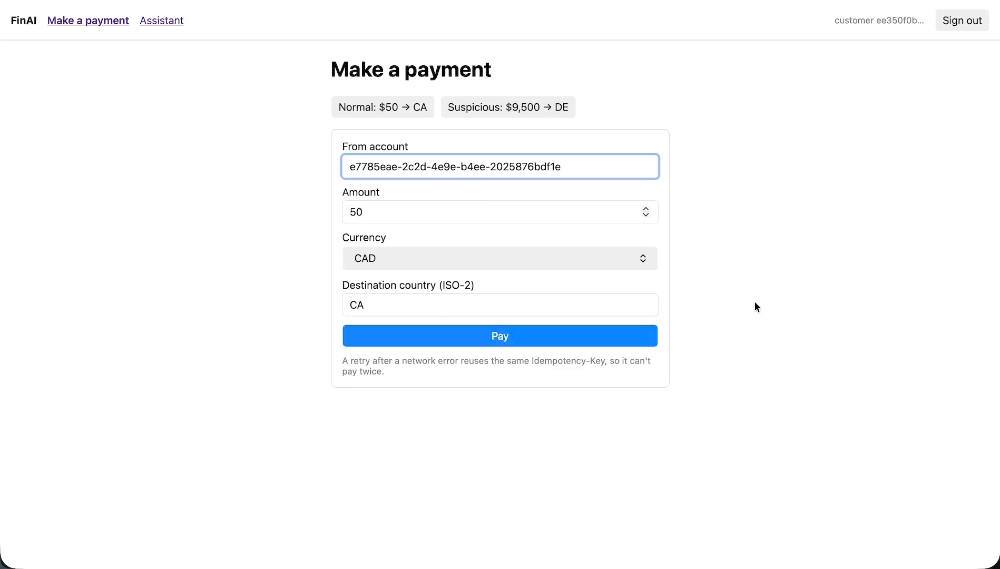

# FinAI

Payments platform with fraud checks. Every payment is scored by fraud rules plus an AI agent that looks at the customer's history. Risky payments are put on hold and a fraud officer reviews them in the operations portal. The AI only investigates; the officer makes the decision.

There is also a support assistant for customers that answers from the public help docs (with citations). If the docs don't cover the question it says it doesn't know.



## Flow

1. Customer creates a payment. The API saves it and writes a `payment.created` event to the outbox.
2. The outbox dispatcher sends it to Kafka. FinAI.Workers picks it up, runs the fraud rules and the Fraud Agent.
3. Low risk: payment is completed. High risk: payment goes OnHold and an alert is pushed to the operations portal over SignalR (risk score, reasons, agent findings).
4. Officer adds a note and approves or escalates. Decision is written to the audit log and the payment status is updated (OnHold -> Completed if approved).

## Stack

- Backend: .NET 10, modular monolith (Identity, Customer, Account, Payment, Fraud, Notification). Modules don't reference each other.
- Messaging: Kafka, transactional outbox, retries, dead-letter topics
- AI: Microsoft.Extensions.AI with OpenAI, RAG on Postgres + pgvector
- Real-time: SignalR (fraud alerts, streaming assistant answers)
- GraphQL: Hot Chocolate, one query for the operations dashboard
- Jobs: Hangfire (knowledge re-index, fraud SLA check, outbox cleanup)
- Observability: OpenTelemetry + Jaeger, Serilog + Seq
- Frontend: Angular 21, two portals + shared-ui library

## Architecture

```
customer-portal   --+                              +--> Postgres (data, outbox, pgvector)
                    +--> FinAI.Api <-- Kafka --> FinAI.Workers
operations-portal --+   REST, GraphQL, SignalR     |    fraud rules + Fraud Agent
                                                   +--> OpenAI
```

- **FinAI.Api**: REST endpoints for the portals, fraud case resolution, GraphQL dashboard query, SignalR hubs.
- **FinAI.Workers**: fraud checks + agent, Hangfire jobs, knowledge base ingestion.

Modules communicate only with events. The business change and the event are saved in the same DB transaction (outbox), so a payment can't end up without a fraud check if something crashes. Consumers are idempotent since Kafka can deliver a message more than once.

Some details:

- Fraud decisions always need an officer and a written note.
- The support assistant only searches documents marked public. If nothing relevant is found it doesn't call the LLM at all. Citations that don't match a retrieved document are removed and logged on the trace.
- Failed messages are retried, then sent to `<topic>.dlt` with the error.
- Trace context is passed in Kafka headers, so one payment = one trace in Jaeger (HTTP request, fraud check, agent, RAG search, SignalR push). The trace id is shown on the review card.
- `POST /payments` supports an `Idempotency-Key` header. Retrying with the same key returns the original result.

## Running locally

Requirements: .NET 10 SDK, Node 20.19+, Docker, OpenAI API key.

Start the infrastructure (Kafka, Postgres + pgvector, Redis, Jaeger, Seq, Kafka UI):

```bash
docker compose up -d
```

Copy `.env.example` and set the JWT signing key and OpenAI key. The apps read normal environment variables (e.g. `JWT__SIGNINGKEY`), so set them in your shell or in the IDE run profile.

Load the help docs into the vector store:

```bash
dotnet run --project src/bootstrap/FinAI.Workers -- ingest-knowledge
```

Run the backend (two terminals):

```bash
dotnet run --project src/bootstrap/FinAI.Api --launch-profile http   # http://localhost:5286
dotnet run --project src/bootstrap/FinAI.Workers
```

Run the portals:

```bash
cd frontend
npm install
npx ng serve customer-portal      # http://localhost:4200
npx ng serve operations-portal    # http://localhost:4201
```

The portals use the Angular dev proxy (`frontend/proxy.conf.json`) so no CORS setup is needed locally.

### Testing the flow manually

1. Sign in to the operations portal as a fraud officer.
2. Sign in to the customer portal as a customer and use the "Suspicious: $9,500 -> DE" preset.
3. The alert should show up in the operations portal after a few seconds.
4. Approve it with a note. The customer's payment status changes to Completed.
5. Search the trace id from the review card in Jaeger.

The "Normal: $50 -> CA" preset is completed directly without review.

### URLs

- Jaeger: http://localhost:16686
- Seq: http://localhost:5341
- Kafka UI: http://localhost:8080
- Hangfire: http://localhost:5286/hangfire (local only)
- GraphQL: `POST http://localhost:5286/graphql` (needs fraud officer token)

## Project structure

```
src/
  bootstrap/        FinAI.Api, FinAI.Workers (hosts + DI setup)
  modules/          Identity, Customer, Account, Payment, Fraud, Notification
  ai/               Abstractions, Rag (search + ingestion), Agents (Fraud, Customer Support)
  building-blocks/  outbox, Kafka, Hangfire, MediatR behaviors, value types, events
frontend/           Angular workspace: customer-portal, operations-portal, shared-ui
knowledge-base/     help/policy docs used by the agents (Markdown + front matter)
tests/              unit, integration, architecture tests
```

Modules don't reference each other and the AI projects don't reference any module. Shared contracts are in `FinAI.AI.Abstractions` and the building blocks, and the hosts wire them together.

## Tests

```bash
dotnet test FinAI.slnx
cd frontend && npx ng test customer-portal --watch=false
```

## Azure

This branch can also run on Azure. Locally nothing changes; the Azure parts only turn on when their settings are present.

- Kafka is replaced by Event Hubs (Kafka endpoint, OAuth with managed identity)
- Postgres Flexible Server with Entra auth instead of a password
- Azure SignalR Service, Azure Cache for Redis, Key Vault
- Entra ID sign-in for both portals (MSAL) instead of the dev token endpoint
- traces/metrics/logs to Application Insights, with a few alerts (dead letters, error rate, agent latency, SLA breaches)
- API, workers and a migrator job on Container Apps, portals on Static Web Apps behind Front Door

Infra is in `deploy/terraform`. Copy `terraform.tfvars.example` to `terraform.tfvars`, fill it in, then:

```bash
cd deploy/terraform
terraform init
terraform apply
```

The images are built from `deploy/docker/Dockerfile` (same file for api, workers and migrator, pick the project with `--build-arg PROJECT=... --build-arg DLL=...`) and pushed to the ACR that terraform creates. On the first apply the images don't exist yet, so push them first or point the apps at a placeholder image. `FinAI.Migrator` runs the EF migrations for all modules and is started as a Container Apps job.
